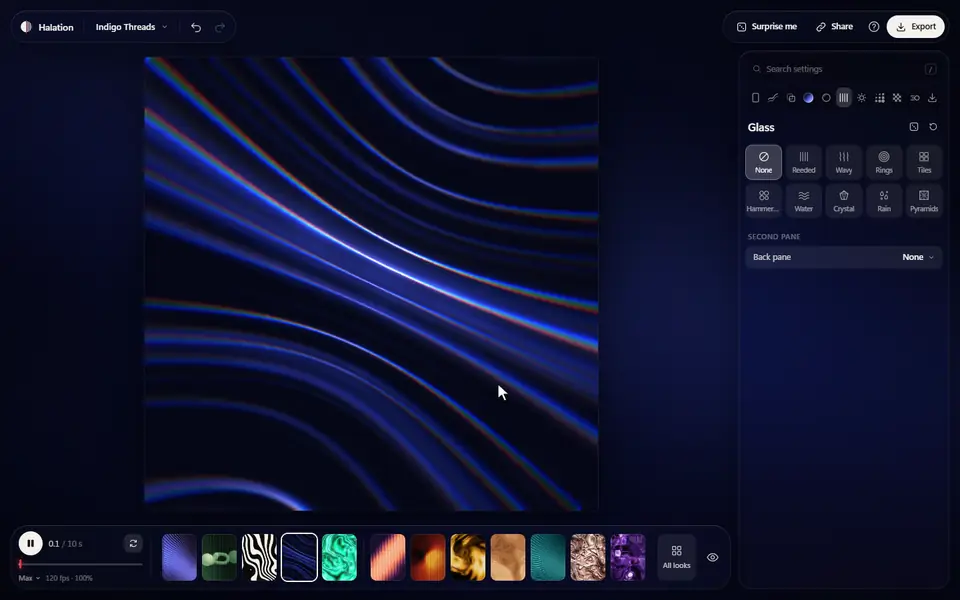
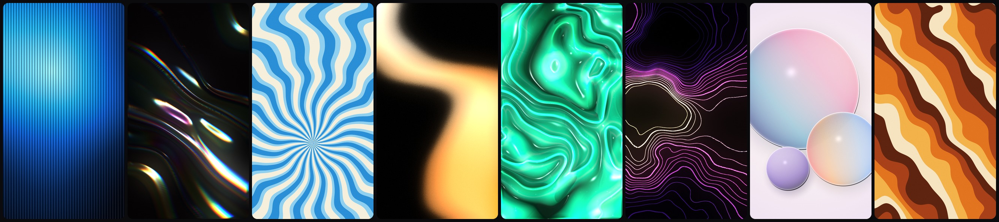
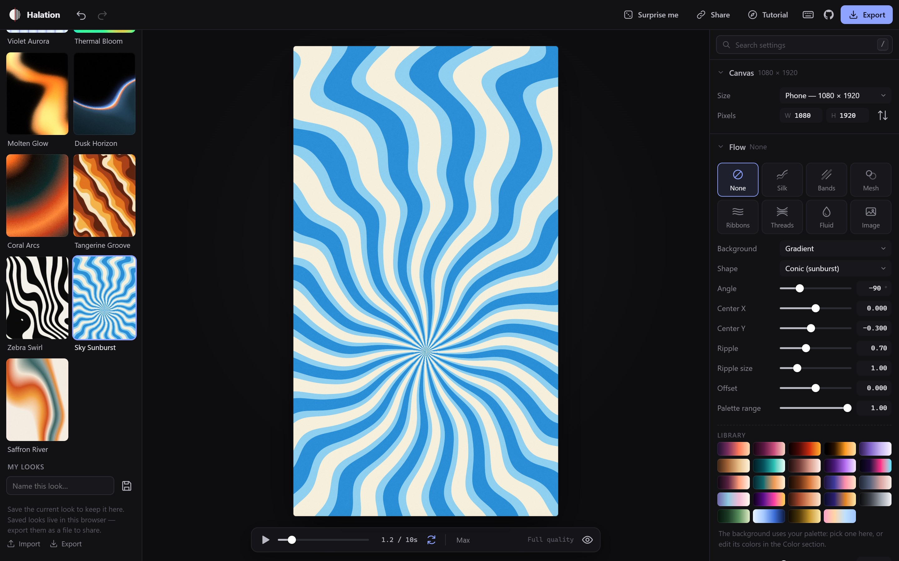
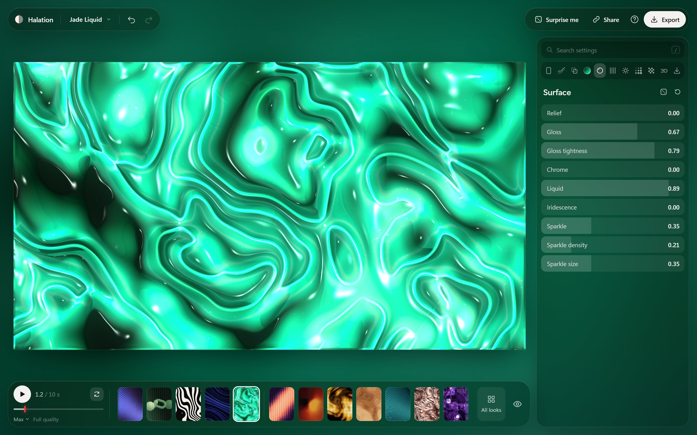
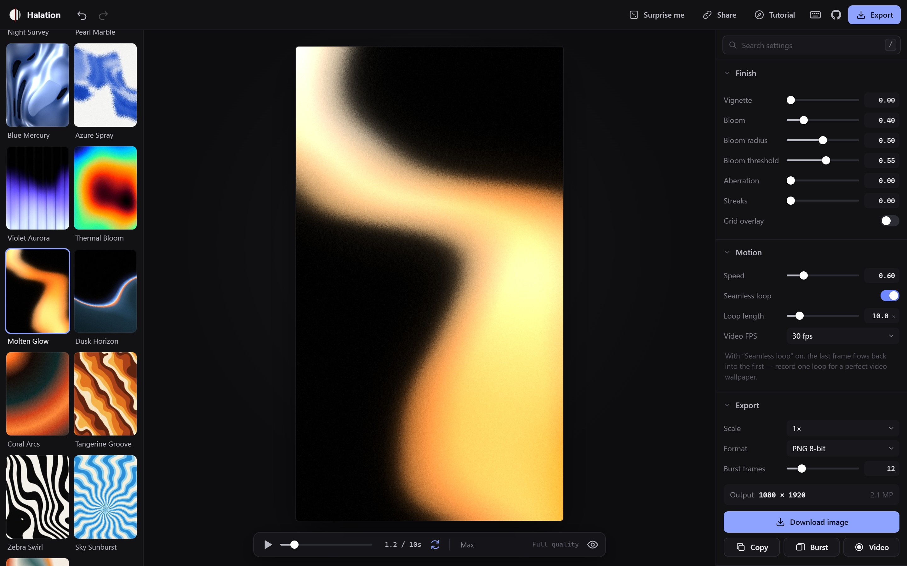

<p align="center">
  <picture>
    <source media="(prefers-color-scheme: dark)" srcset="assets/logo-mark-light.svg">
    
  </picture>
</p>

<h1 align="center">Halation</h1>

<p align="center"><b>Fluid gradients behind textured glass — a free, open-source background generator for designers.</b></p>

<p align="center">
  <a href="https://ar13x3.github.io/halation/"><b>Open the app</b></a> ·
  <a href="docs/GUIDE.md">User guide</a> ·
  <a href="CONTRIBUTING.md">Contributing</a> ·
  <a href="#license">License</a>
</p>



Halation renders flowing color fields behind physically based glass and screen effects: reeded and frosted glass, crystal, rain on a window, liquid chrome, iridescent films, threads of light, halftone, moiré, contour lines and more. Tweak everything live, then export high-resolution stills (up to 16-bit PNG), bursts of frames or seamless-loop videos.

It runs entirely in your browser on the GPU. Nothing to install, no account, and nothing you make is uploaded.

## Screenshots





| Surface | Export |
| --- | --- |
|  |  |

## Quick start

**Use it online:** open **[ar13x3.github.io/halation](https://ar13x3.github.io/halation/)** in a current Chrome, Edge, Firefox or Safari.

1. Choose an output size in **Canvas** (phone, desktop, 4K, square, print…).
2. Click a look in the dock, or press **Surprise me**.
3. Adjust the flow, colors, glass and finish until it's yours.
4. Pause on a frame you like and press **Export**, or record a seamless loop as video.

Made something you like? Post it in **[Show and tell](https://github.com/AR13X3/halation/discussions/categories/show-and-tell)** with its share link, so others can open the look and make it their own.

The **[user guide](docs/GUIDE.md)** covers every control, export option, recipes for common tasks and troubleshooting.

**Run it locally:** there is no build step and no dependencies.

```bash
git clone https://github.com/AR13X3/halation.git
cd halation
npm start
```

Then open http://localhost:5173. Any static file server works; the page must be served over HTTP rather than opened from disk.

## Features

**Flow**: the moving color field behind the glass.
Silk, light bands, mesh gradients, ribbons, threads of light that can pinch into an hourglass or a starburst, a real-time fluid simulation you paint with the mouse, or any image you drop in. Or no flow at all: a still color or gradient background. A silhouette can shape any flow into a sculpted ribbon, wave or blob over a plain backdrop.

**Objects**: up to six spheres, pills, panes and chain links floating in front of the flow, in frosted or clear glass or a solid material. Each has its own shape, color (from the palette, any color, or a gradient from the library), tint, frost, size, position and rotation; drag them on the canvas to compose. Glass objects refract and blur what is behind them, catch light along their edges and cast soft, colored shadows.

**Color**: gradient editor with smooth OKLab blending, palette library and generator, repeats, posterize and animated color cycling.

**Surface**: lights the flow as a 3D surface: relief, gloss, polished chrome, clear liquid, thin-film iridescence (soap bubbles, oil, holographic foil) and twinkling sparkles.

**Glass**: physically based light transport.
- Nine glass types: reeded, wavy, rings, glass-block tiles, hammered, water, crystal, rain on a fogged window, and prism pyramids
- Refraction with adjustable index of refraction, frost, streaks, spectral dispersion and caustics
- Fresnel reflections, total internal reflection, highlights and tinted glass
- Partial panes (one side, a window or a band) and a second stacked pane

**Screen**: halftone, line screens, moiré engraving, LED matrix, CRT, mosaic, topographic contours and dither.

**Finish**: grading, film grain, vignette, bloom, spectral chromatic aberration, zoom, spin and directional streaks, and a grid overlay.

**Export**
- PNG, 16-bit PNG (no banding), JPEG or WebP at 0.5×–4× any canvas size
- Copy to clipboard, burst capture as a .zip, and seamless-loop video (MP4/WebM)
- Size presets for phones, desktops up to 5K, banners and A4 print

**Workflow**: 41 built-in looks, a guided tutorial, searchable settings, Surprise me, undo/redo, saved looks with import/export, and share links that recreate a look exactly.

**Runs on modest hardware**: performance modes (Auto, Eco, Balanced, Max) and dynamic resolution keep the preview smooth. Paused frames refine to full quality and exports render identically on any machine.

## How it works

Each frame runs up to six GPU passes:

```
field ─▶ glass ─▶ screen ─▶ (streaks) ─▶ bloom ─▶ finish
```

1. **Field** computes the flow value for each pixel (noise, bands, mesh, ribbons, threads, fluid dye, image or a still background), maps it through the palette, applies the silhouette and draws solid objects.
2. **Glass** lights the flow as a surface (relief, chrome, liquid, thin-film interference, sparkles), then traces light through the glass objects and each pane: refraction, Monte Carlo frost, streaks and spectral dispersion, then tint, caustics, Fresnel reflection, total internal reflection and highlights. Jittered passes are averaged for clean, antialiased stills.
3. **Screen** resamples the result on a cell grid for halftone, LED, contour and other patterns.
4. **Streaks** smears the image in three passes of growing length, for a smooth zoom, spin or directional blur.
5. **Bloom** blurs the brightest areas at quarter resolution.
6. **Finish** applies spectral aberration, grading, vignette, grid, grain and dithering.

All sizes are relative to the canvas height, so a 4× export looks exactly like the preview, only sharper. Exports render offscreen and stream into a built-in PNG encoder (which makes 16-bit output possible) using the browser's native compression.

Built with plain JavaScript and WebGL 2. No frameworks, no build step, no dependencies. See [CONTRIBUTING.md](CONTRIBUTING.md) for the project structure and how to add effects.

## Contributing

Bug reports, new looks, effects and documentation improvements are welcome. Please read the [contributing guide](CONTRIBUTING.md) first; it explains the development setup, guidelines and how contributions are licensed. Everyone taking part is expected to follow the [Code of Conduct](CODE_OF_CONDUCT.md).

To report a security issue, see the [security policy](SECURITY.md). For accessibility support and known limitations, see [ACCESSIBILITY.md](ACCESSIBILITY.md).

## License

Halation is free and open-source software, licensed under the **[GNU Affero General Public License v3.0](LICENSE)** (AGPL-3.0-only).

- You may use, study, share and modify it.
- If you distribute a modified version, or run one as a service that others use over a network, you must make its complete source code available under the same license.
- **What you create is yours.** Images and videos you make with Halation belong to you and are not covered by this license. Use them anywhere, including commercial work.
- **Commercial licensing.** To use Halation in a closed-source product or under other terms, contact the author through [GitHub](https://github.com/AR13X3).
- **Trademarks.** The Halation name and logo are not licensed for use in other products or services.

Copyright © 2026 AR13X3.

## Credits

Created by [AR13X3](https://github.com/AR13X3), developed with the help of [Claude Code](https://claude.com/claude-code).

- 4D simplex noise: Ashima Arts and Stefan Gustavson ([webgl-noise](https://github.com/ashima/webgl-noise), MIT)
- Hash functions: Dave Hoskins ("Hash without Sine", MIT)
- Fluid solver after Jos Stam's *Stable Fluids*, adapted from Pavel Dobryakov's [WebGL Fluid Simulation](https://github.com/PavelDoGreat/WebGL-Fluid-Simulation) (MIT)
- Voronoi techniques: Inigo Quilez
- OKLab color space: Björn Ottosson

Full notices for included third-party code are in [THIRD_PARTY_NOTICES.md](THIRD_PARTY_NOTICES.md).
